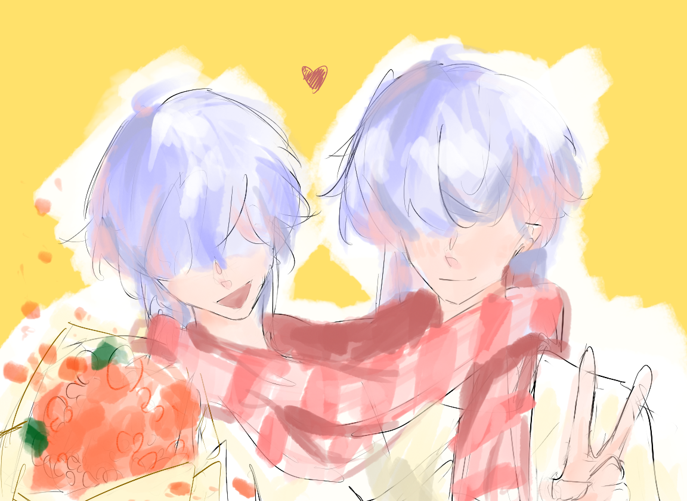
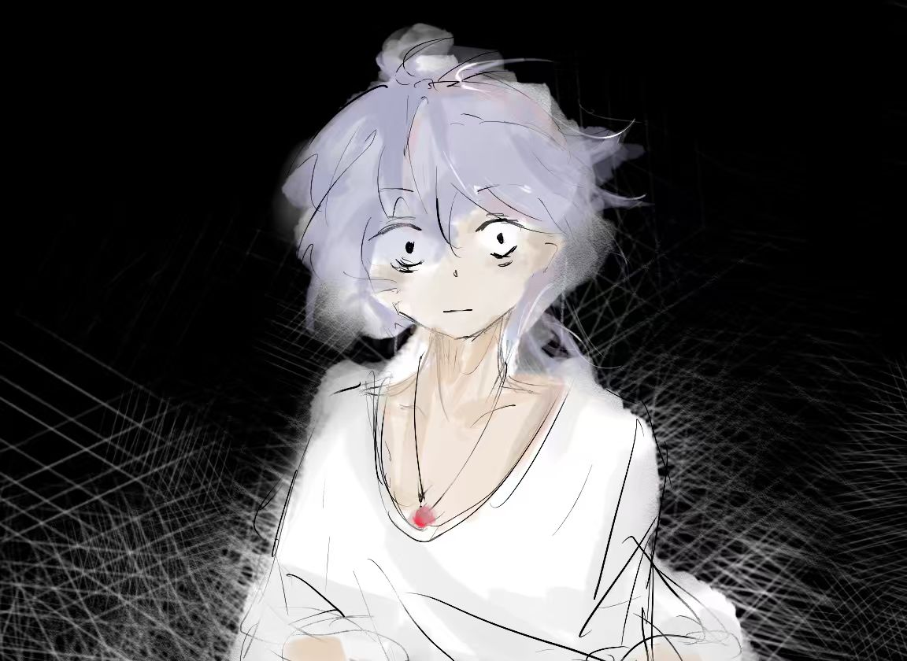
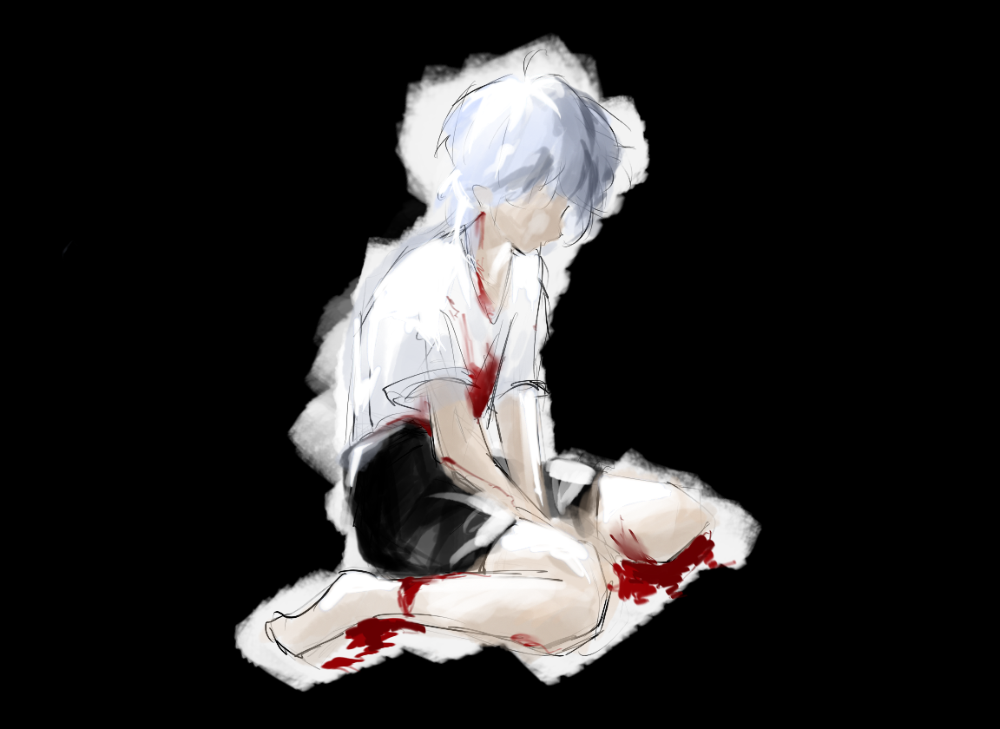

# 心之宫 (The Palace of Heart)

<p align="center">
  
</p>

一款基于 C++ 和 EasyX 图形库开发的迷宫逃脱游戏，融合了剧情叙事、BOSS战斗和双人对战等丰富玩法。

## 🎮 游戏简介

《心之宫》是一款充满心理隐喻的迷宫逃脱游戏。玩家需要在黑暗的迷宫中收集物品、躲避追击者，最终到达出口。游戏包含深刻的剧情叙事，讲述了一个关于自我认知与接纳的故事。

### 游戏模式

- **单人模式**: 在迷雾笼罩的迷宫中逃脱追击者，通过5个普通关卡后挑战最终BOSS
- **双人模式**: 两名玩家竞争收集物品，使用炸弹、地雷和大招互相干扰，争夺最高分

## ✨ 游戏特色

### 核心玩法
- 🌫️ **战争迷雾系统**: 单人模式下视野受限，增加紧张感
- 🏃 **智能追击AI**: 敌人使用BFS寻路算法追踪玩家
- 🛒 **商店升级系统**: 通关后可购买速度、护盾等升级
- ⏱️ **时间停止技能**: 短暂冻结敌人的特殊能力

### BOSS战 (单人模式第6关)
BOSS拥有6个独特技能阶段，每个阶段持续不同时间：

| 阶段 | 技能名称 | 时间段 | 描述 |
|------|----------|--------|------|
| 壹式 | 心火狱炎剑 | 0-20秒 | 横向斩击攻击 |
| 贰式 | 十世妄执剑 | 20-60秒 | 单激光扫射 |
| 叁式 | 九重天罚剑 | 60-80秒 | 密集炸弹雨 |
| 肆式 | 限月缚光斩 | 80-140秒 | 多道激光交叉 |
| 伍式 | 浮世销名斩 | 140-180秒 | 快速金色激光 |
| 陆式 | 轮回困笼 | 180-220秒 | 轨迹墙壁生成 |

### 双人模式特色
- 💣 **炸弹系统**: 放置普通炸弹和固定地雷
- ⚡ **大招激光**: 冷却后可发射强力激光
- 🌧️ **精神错乱**: 定时随机炸弹雨事件
- 🏆 **分数竞争**: 击中对手可偷取分数

## 🎛️ 操作说明

### 单人模式
| 按键 | 功能 |
|------|------|
| W/A/S/D | 移动 |
| E | 进入出口 |
| K | 时间停止 |
| P | 暂停游戏 |
| ESC | 返回主菜单 |

### 双人模式
| 玩家1 | 玩家2 | 功能 |
|-------|-------|------|
| ↑/←/↓/→ | W/A/S/D | 移动 |
| 空格 | F | 放置炸弹 |
| M | G | 放置地雷 |
| L | X | 发射大招 |
| K | R | 时间停止 |

### 通用
| 按键 | 功能 |
|------|------|
| E | 进入出口/确认 |
| P | 暂停/继续 |
| SPACE | 对话继续 |
| Z | 跳过对话 |
| Q | 退出游戏 |
| R | 重新开始 |


## 📁 项目结构

```
MazeGame/
├── src/
│   ├── main.cpp          # 程序入口
│   ├── game.cpp          # 游戏主循环
│   ├── game_boss.cpp     # BOSS技能逻辑
│   ├── game_input.cpp    # 输入处理
│   ├── game_level.cpp    # 关卡管理
│   ├── render.cpp        # 渲染系统
│   ├── entities.cpp      # 实体管理（玩家、敌人、NPC）
│   ├── maze.cpp          # 迷宫生成算法
│   ├── bombs.cpp         # 炸弹系统
│   ├── shop.cpp          # 商店系统
│   ├── audio.cpp         # 音频系统
│   ├── globals.cpp       # 全局变量
│   └── common.h          # 公共定义
├── asset/                # 游戏资源（图片）
│   ├── emoji/            # 表情图片
│   ├── Start1.png        # 单人模式开场图
│   ├── Start2.png        # 双人模式开场图
│   ├── BOSS.png          # BOSS战背景
│   ├── Lose.png          # 失败画面
│   ├── win1.png          # 胜利画面1
│   ├── win2.png          # 胜利画面2
│   └── Ending.png        # 结局画面
├── Music/                # 游戏音乐
│   ├── Enter.wav         # 主菜单音乐
│   ├── Background.wav    # 背景音乐
│   ├── Background1.wav   # 背景音乐（前期关卡）
│   ├── BossBGM.wav       # BOSS战音乐
│   ├── Win.wav           # 胜利音乐
│   ├── Death.wav         # 死亡音乐
│   ├── Heartbeat.wav     # 心跳声效
│   ├── Caught.wav        # 被抓音效
│   └── 2P*.wav           # 双人模式音乐
├── CMakeLists.txt        # CMake配置文件
└── README.md             # 本文件
```

## 🎨 技术特点

- **迷宫生成**: 使用随机化深度优先搜索(DFS)算法生成迷宫
- **寻路算法**: BFS广度优先搜索实现敌人智能追踪
- **平滑动画**: 插值算法实现流畅的角色移动
- **渲染优化**: 迷宫缓存、批量绘制提升性能
- **模块化设计**: 代码按功能拆分为多个模块

## 🎵 音频

游戏包含完整的音频系统：
- 背景音乐随关卡变化
- 心跳声效营造紧张氛围
- 各种交互音效

## 📸 游戏截图

<p align="center">
  <i>主菜单</i><br>
  
</p>

<p align="center">
  <i>BOSS战</i><br>
  
</p>

## 👥 开发团队

- **主程序开发**: ZhaoKun Chen, Ran Tao
- **技术指导**: ZhaoKun Chen, Ran Tao
- **音乐与音效**: ZhaoKun Chen, Ran Tao
- **质量保证**: ZhaoKun Chen, Ran Tao, Kumoutau

## 📄 许可证

本项目仅供学习交流使用。

## 🙏 致谢

- [EasyX 图形库](https://easyx.cn/) - 提供便捷的 Windows 图形编程接口
- ShanghaiTech University CS101A 课程

---

<p align="center">
  <b>感谢游玩《心之宫》！</b><br>
  <i>"去拥抱那个独特的你吧！"</i>
</p>
